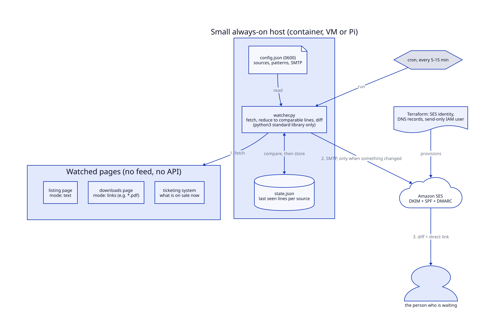

# calendar-change-watcher

Watches web pages that have no feed and no API, and emails you a diff when they
change. Nothing changed means no email, which is what makes it bearable at a
five minute interval.

It was written for a repertory cinema whose calendar appears a couple of weeks
ahead and whose popular shows sell out the same evening tickets open. Checking
by hand meant refreshing three pages all day. The same shape fits anything where
being told within minutes is worth more than a tidy integration: class
registration, permit lotteries, a venue schedule, a store restock page.



## How it works

Each run fetches every configured source, reduces the page to the lines a reader
would actually care about, and compares them with the previous run stored in a
small JSON file. If anything was added or removed, it sends one email listing the
differences and the links to act on.

Three details do most of the work:

- **Reduce before comparing.** Raw HTML changes constantly: nonces, counters,
  rotating banners. Sources are reduced to visible text lines, or to matching
  hyperlinks, so the diff reflects content rather than markup.
- **Watch the file list, not just the page.** Sites often publish a new month as
  a PDF whose name carries the date. `mode: "links"` compares hyperlinks, so a
  new file appearing is unmissable even when the page text is unchanged.
- **Watch the ticketing system too.** The listing page and the moment tickets
  actually go on sale are rarely the same event, and the second one is the one
  you care about. It is just another source.

Anything matching `highlight_pattern` gets its own subject line, so the thing you
are waiting for reads differently from routine updates.

Fetch failures are logged and skipped rather than emailed, because a transient
timeout is not news. A source that has been failing for a day is mentioned in the
next real alert.

## Quick start

```bash
git clone https://github.com/defenestratexp/calendar-change-watcher
cd calendar-change-watcher
cp config.example.json config.json    # edit: sources, recipients, SMTP

# see what each source currently extracts, and tune the patterns
python3 watcher.py --config config.json --show

# first run stores a baseline and sends nothing
python3 watcher.py --config config.json --state state.json

# print the email instead of sending it
python3 watcher.py --config config.json --state state.json --dry-run
```

Then run it from cron, typically every 5 to 15 minutes:

```cron
*/15 * * * * /usr/bin/python3 /opt/watcher/watcher.py >/dev/null 2>&1
```

Requirements: python3 and nothing else. It runs comfortably in a 256 MB
container.

## Configuration

`config.example.json` is a complete example. The fields that matter:

| Field | Meaning |
| --- | --- |
| `sources[].name` | Label used in the email and in stored state |
| `sources[].url` | Page to fetch |
| `sources[].mode` | `text` (default) compares visible text; `links` compares hyperlinks |
| `sources[].link_pattern` | With `links`: which hrefs to keep, e.g. `[^"]+\.pdf` |
| `sources[].keep_pattern` | Keep only lines matching this (use `--show` to tune) |
| `sources[].drop_pattern` | Drop lines matching this: nav, cookie notices, counters |
| `highlight_pattern` | Lines matching this trigger `highlight_subject` |
| `recipients`, `sender`, `reply_to` | Addressing |
| `smtp_host`, `smtp_port`, `smtp_user`, `smtp_password` | Any SMTP server |
| `footer_links` | Links appended to every alert, so acting is one click away |

Keep `config.json` mode 0600: it holds the SMTP password.

## Sending mail with Amazon SES

Any SMTP server works. SES is convenient because a new domain can be signed
properly in minutes, and unsigned mail from an unfamiliar sender lands in spam,
which would defeat the purpose.

The `terraform/` directory creates the sending domain, its DKIM, SPF and DMARC
records in Route 53, and an IAM user allowed to send from exactly one address and
nothing else. It deliberately does not create the access key, so no live
credential ends up in Terraform state:

```bash
cd terraform
terraform init
terraform apply -var mail_domain=example.com -var hosted_zone_id=Z... \
                -var dmarc_report_address=you@example.com
aws iam create-access-key --user-name "$(terraform output -raw mailer_user)"
```

SES SMTP does not take the secret access key directly; it takes a password
derived from it. Deriving it locally keeps the AWS SDK off the watcher host:

```python
import base64, hmac, hashlib
def sign(key, msg): return hmac.new(key, msg.encode(), hashlib.sha256).digest()
k = sign(("AWS4" + SECRET_ACCESS_KEY).encode(), "11111111")
for part in (REGION, "ses", "aws4_request", "SendRawEmail"):
    k = sign(k, part)
print(base64.b64encode(b"\x04" + k).decode())   # smtp_password
```

`smtp_user` is the access key id, and `smtp_host` is
`email-smtp.<region>.amazonaws.com`. Sending to arbitrary recipients requires
production access in that region; a sandboxed account can only mail verified
addresses.

## Notes and limits

- Pages rendered entirely by JavaScript will not work: it reads the HTML the
  server returns. Look for the underlying listing or ticketing URL instead.
- Be a considerate client. Every 5 minutes against a couple of pages is polite;
  every 10 seconds is not. The user agent identifies the tool.
- Diffs are line based, so a site restyle can produce one noisy email before the
  new baseline settles.
- State is a single JSON file. Delete it to start over; the next run is treated
  as a first run and sends nothing.

## License

MIT
